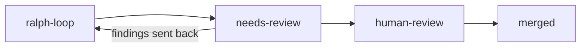

# gocache

A Redis-style in-memory key-value cache server in Go, built phase by phase from a written spec ([SPEC.md](SPEC.md)). The spec and the tests come first; the implementation follows. Project conventions and per-phase decisions are in [CLAUDE.md](CLAUDE.md).

## Features by phase

- **Phase 1, store:** `SET key value [ttl_seconds]`, `GET key`, `DEL key` with optional per-key expiry, checked lazily on access.
- **Phase 2a, wire protocol:** newline-terminated text commands over TCP on port 6380; values wrapped in `$`; malformed input returns `invalid command` and keeps the connection open.
- **Phase 2b, concurrency:** one goroutine per connection; the store is the only shared state, guarded by a single `sync.Mutex`. A sharded store exists for benchmarking only (see [BENCHMARKS.md](BENCHMARKS.md)).
- **Phase 3, active expiry:** a background sweep (every 100ms) reclaims memory from expired keys; it never changes command results.
- **Phase 4, graceful shutdown:** SIGINT/SIGTERM stop accepting, drain connections, stop the sweep, then exit 0. A second signal exits immediately.
- **Phase 5, persistence:** the store is snapshotted to `dump.gocache` every 60 seconds and at shutdown, and loaded at startup. A corrupt snapshot stops startup.
- **Phase 6, connection limits:** at most 1000 clients (extra ones get `max clients reached`), a 5 minute idle timeout per line, and a 10 second write timeout.
- **Phase 7, TTL query:** `TTL <key>` returns the whole seconds remaining, `-1` for no expiry, or a miss. Specified in SPEC.md; implementation is in progress.

## Run it

```
go run ./cmd/server
```

The server listens on port 6380. Example session:

```
$ nc localhost 6380
SET foo $bar$ 30
1
GET foo
True $bar$
DEL foo
1
GET foo
False $nil$
```

Commands are case sensitive and upper case. Values are wrapped in `$`, and `$` is not allowed anywhere else.

## Test it

```
go test ./...
go test -race ./...
```

## How it's built: the Ralph Loop

Work is done by two scheduled agents under the owner's control.

1. The owner writes the spec and the failing tests first, then files a GitHub issue with the goal, files to touch, gate commands, what is out of scope, and a `**Blocked by:**` line.
2. A scheduled **writer** agent picks the oldest unblocked `ralph-loop` issue, implements it on an `issue-N-slug` branch, loops until the gate passes, opens a PR, and labels the issue `needs-review`.
3. A scheduled **reviewer** agent, in fresh context, checks the diff against the spec for spec gaps, tests that cannot fail, and logic bugs. Fixable findings go back to the writer (max 2 rounds). Spec or scope questions escalate.
4. The owner only sees `human-review` issues: reads the diff, breaks the code to confirm each test can fail, then merges.

Label flow:



Plain text: `ralph-loop -> needs-review -> human-review -> merged`, with the reviewer sending an issue back from `needs-review` to `ralph-loop`.

## Repo layout

- `cmd/server`: the server binary; startup, snapshot load and save, signal handling.
- `internal/store`: all store logic (entries, TTLs, lazy and active expiry); no networking.
- `internal/protocol`: wire-format parsing only; no store or networking code.
- `internal/server`: connection handling, command dispatch, shutdown, connection limits.
- `internal/snapshot`: snapshot file format and atomic file writing; depends on `internal/store`.
